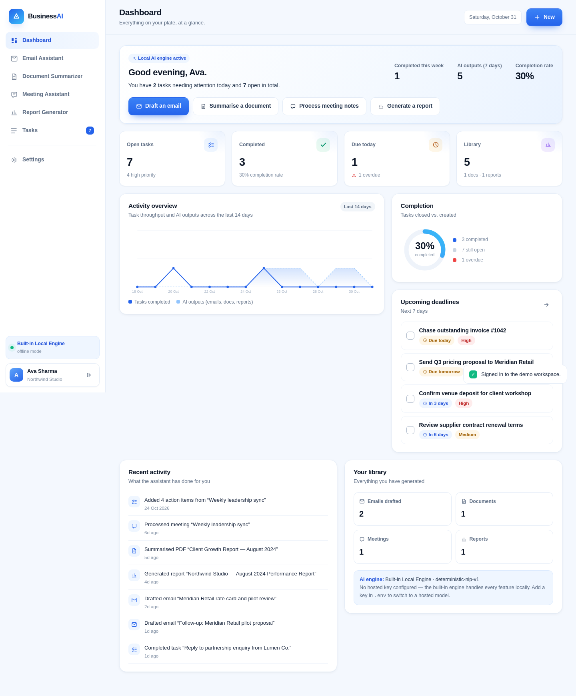

# AI Business Assistant

A complete, working AI assistant for students, entrepreneurs and small business owners:
draft and rewrite emails, summarise documents, turn meeting notes into decisions and
tasks, generate downloadable business reports, and manage the resulting work.

Built with **Node.js + Express + SQLite**, a **zero-build vanilla-JS SPA** front end and a
pluggable AI layer that runs on a hosted LLM when a key is configured and on a built-in
deterministic engine when it is not.



---

## Quick start

```bash
npm install
npm start            # http://localhost:4173
```

The first boot creates a SQLite database in `data/` and seeds a demo workspace.

**Demo account**

```
Email:    demo@bizassist.ai
Password: Demo1234
```

Or press **“Explore the demo workspace”** on the sign-in screen, or register a fresh
account to see the empty-state onboarding.

### Optional: connect a hosted AI model

Copy `.env.example` to `.env`, add **one** key and restart:

```bash
OPENAI_API_KEY=sk-...            # or
ANTHROPIC_API_KEY=sk-ant-...     # or
GEMINI_API_KEY=...               # or
OPENROUTER_API_KEY=...
```

At boot the server probes the provider once. If the key is rejected, the app logs the
reason and transparently falls back to the built-in engine — no broken output, no error
screens. The active engine is always shown in the sidebar and on the dashboard.

> Keys are read from `process.env` on the server only. They are never bundled, never sent
> to the browser and never logged.

---

## Features

### 1. AI Email Assistant
- **New email / follow-up / reply** modes with **formal, professional and friendly** tones.
- Rewrite an informal message into polished business prose (phrase mapping, contraction
  expansion, emoji stripping, greeting/sign-off repair) with a change report.
- Generates subject line, body and improvement tips; copy, download `.txt`, open in the
  mail client, or convert the draft into a follow-up task.
- Every draft is stored in a searchable history.

### 2. Document Summarizer
- Drag-and-drop **PDF, TXT, MD, CSV** (8 MB limit) or paste text.
- Returns an extractive summary, key points, **dates** (normalised to ISO), **figures**
  (currency, percentages, quantities with context) and **action items** with owner and due
  date. Action items can be pushed to the task list in one click.
- Upload validation: extension + MIME + `%PDF-` signature, size cap, encrypted-PDF and
  image-only PDF detection with actionable error messages.

### 3. Meeting Assistant
- Paste notes or a transcript (wrapped lines are re-joined automatically).
- Produces a summary, explicit **decisions**, and **action items** with owner extraction
  (`Daniel will…`, `Priya to…`, `Finance needs to…`), deadline parsing and priority cues.
- Optionally creates tasks automatically, linked back to the meeting.

### 4. Business Report Generator
- Accepts free-form metrics (current + previous period) plus context notes.
- Computes period-on-period deltas, profit, margin and expense-vs-revenue divergence, then
  writes a six-section report: executive summary, performance table, observations,
  recommendations, risks, next steps.
- Download as **Markdown** or styled **HTML**, or print to PDF straight from the browser.

### 5. Task Management
- Create, edit status, prioritise (high/medium/low), due dates, overdue detection.
- Filters by status and priority, plus search.
- Tasks created from emails, documents and meetings keep a source link.

### Dashboard
Live statistics, 14-day activity chart (SVG, no chart library), completion donut,
upcoming deadlines, recent activity feed and a library summary.

---

## Design

- Light blue / white SaaS palette, system-UI typography with tight tracking, 1px borders
  and layered soft shadows.
- Sidebar navigation that becomes an off-canvas drawer below 980px.
- Staggered entrance animations, skeleton loaders, toasts, modals, and a
  `prefers-reduced-motion` escape hatch.
- Fully responsive from 320px up; all views verified at 1440px and 390px.

---

## Architecture

```
server/
  index.js              Express app, security headers, static SPA, error layer
  db.js                 node:sqlite schema + helpers (no native modules)
  auth.js               scrypt hashing, server-side sessions, CSRF shield, rate limits
  seed.js               demo workspace content
  ai/
    index.js            provider resolution, boot probe, JSON task runner, fallback
    local.js            deterministic engine (email, rewrite, doc, meeting, report)
  lib/
    text.js             sentence splitting, extraction, summarisation, entity parsing
    extract.js          upload validation + PDF/text extraction
  routes/
    auth.routes.js      register/login/logout/profile/password/delete
    tasks.routes.js     task CRUD, toggle, bulk creation
    workspace.routes.js emails, documents, meetings, reports, export
    stats.routes.js     dashboard aggregation
public/
  index.html            app shell (auth screen + dashboard shell)
  css/app.css           design system
  js/app.js             bootstrap, router, shell
  js/api.js             fetch wrapper with typed errors
  js/ui.js              escaping, icons, toasts, modals, markdown, charts
  js/views/*.js         dashboard, email, documents, meetings, reports, tasks, settings
```

**Database** (SQLite, WAL): `users`, `sessions`, `tasks`, `documents`, `emails`,
`meetings`, `reports`, `activity`. Every query is scoped by `user_id`.

---

## Security

| Concern | Approach |
| --- | --- |
| Passwords | `scrypt` (64-byte digest) with a unique 16-byte salt per user; constant-time compare |
| Sessions | 256-bit opaque tokens stored server-side, delivered as `HttpOnly`, `SameSite=Lax`, `Secure`-in-production cookies; 7-day expiry |
| CSRF | SameSite cookies + origin/host verification on all state-changing requests |
| XSS | All dynamic content escaped before interpolation; strict CSP (`script-src 'self'`, no inline scripts) |
| Tenant isolation | Every read/write filtered by the authenticated `user_id` |
| Uploads | Extension + MIME + magic-byte check, 8 MB cap, single file, memory storage only |
| Brute force | Sliding-window rate limits on login/register |
| API keys | Server-side environment variables only; a boot probe reports the active provider |
| Headers | `X-Content-Type-Options`, `X-Frame-Options`, `Referrer-Policy`, CSP |

---

## API

All endpoints are JSON and require a session cookie unless marked public.

| Method | Path | Purpose |
| --- | --- | --- |
| `GET` | `/api/public/status` | Public: app + AI engine status |
| `POST` | `/api/auth/register` · `login` · `logout` | Session lifecycle |
| `GET/PATCH` | `/api/auth/me` | Profile |
| `POST` | `/api/auth/password` | Change password |
| `DELETE` | `/api/auth/account` | Delete account |
| `GET/POST` | `/api/tasks` | List (filters) / create |
| `PATCH` | `/api/tasks/:id` | Update |
| `POST` | `/api/tasks/:id/toggle` | Complete / reopen |
| `POST` | `/api/tasks/bulk` | Create many (from documents or meetings) |
| `GET/POST` | `/api/emails` | History / generate |
| `POST` | `/api/emails/rewrite` | Rewrite an informal message |
| `GET/POST` | `/api/documents` | Library / upload or paste |
| `GET/POST` | `/api/meetings` | Library / process notes |
| `GET/POST` | `/api/reports` | Library / generate |
| `GET` | `/api/reports/:id/download?format=md\|html` | Download |
| `GET` | `/api/stats` | Dashboard aggregates |
| `GET` | `/api/export` | Full JSON export of the signed-in user's data |

---

## The offline engine

Most "AI" demos break without a key. This app ships a deterministic NLP engine that runs
the same feature set locally:

- **Summarisation** — frequency × position weighted sentence ranking with cue boosting and
  an action-item penalty, so narrative stays separate from to-dos.
- **Extraction** — regex + heuristics for dates (absolute, relative, weekday), currency,
  percentages, quantities, owners, deadlines and priority cues.
- **Generation** — tone-specific phrase libraries, instruction-to-request rewriting, and
  report narratives driven by real arithmetic on the supplied metrics.

The hosted path uses the same JSON contract, so switching providers changes nothing else.

---

## Notes & limitations

- SQLite in `data/` is ideal for a single-instance deployment; point `DATA_DIR` at a
  persistent volume in production.
- Image-only (scanned) PDFs need OCR before upload — the app detects this and says so.
- Reports state that figures must be validated against the source ledger; the generator
  computes only from supplied numbers and never invents metrics.
- `node:sqlite` requires Node **22+** (tested on 24).

## Docker

```bash
docker build -t bizassist .
docker run -p 4173:4173 -v "$PWD/data:/app/data" --env-file .env bizassist
```

## Scripts

```bash
npm start      # production start
npm run dev    # start with --watch
npm run seed   # ensure the demo workspace exists
```
# AI-business-Assistant

